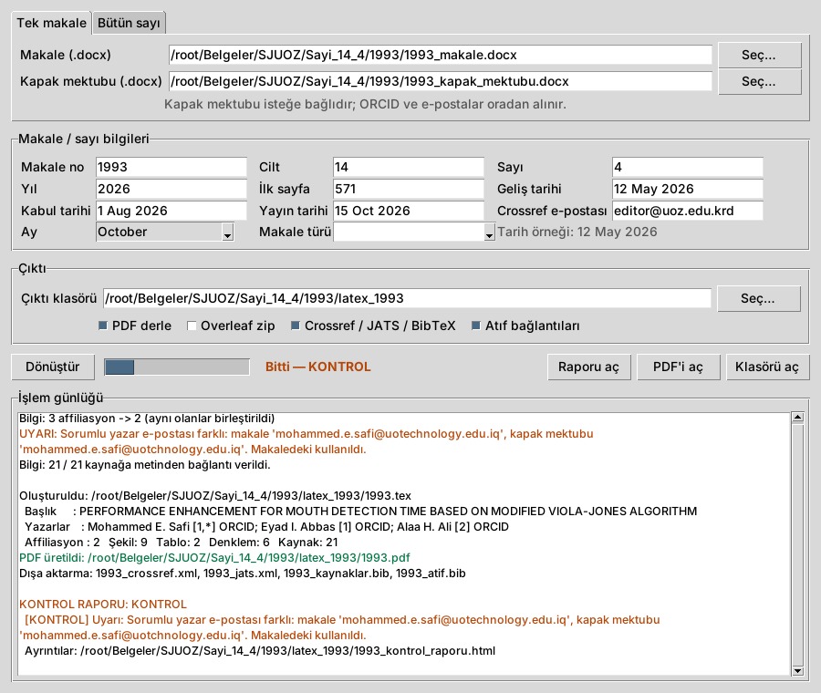

# SJUOZ Word → LaTeX Dönüştürücü

Makale (manuscript) ve kapak mektubu (cover letter) Word dosyalarını
**Science Journal of University of Zakho (SJUOZ)** şablonunda XeLaTeX'e çevirir. Tek seferde:

* SJUOZ biçiminde `.tex` ve **PDF** (ilk sayfa logosu, QR kodlu bilgi kutusu, iki sütun, başlık/altlık),
* Word'deki **bütün resimler ve grafikler** (`figures/`), Overleaf'e yüklenebilir **zip**,
* editör için **kontrol raporu** (eksik resim/tablo, kaybolan metin, atıf sorunları, LaTeX hataları),
* **Crossref XML** (DOI kaydı, resmi şemayla doğrulanmış), **JATS XML** (indeksleme), **BibTeX**.

Bütün bir sayı da tek komutla işlenir; sayfa numaraları makaleden makaleye zincirlenir.

---

## 1. Kurulum ve çalıştırma

### a) Windows: hazır program (Python gerekmez)
GitHub → **Actions** → *SJUOZ Word2LaTeX testleri* → son çalışma → **SJUOZ-Word2LaTeX-Windows**
dosyasını indirin. İçinde iki program vardır:

* `SJUOZ-Word2LaTeX.exe` — pencere arayüzü (çift tıklayın),
* `sjuoz-word2latex.exe` — komut satırı.

PDF'in otomatik derlenmesi için bilgisayarda **MiKTeX** (veya TeX Live) kurulu olmalıdır;
yoksa üretilen zip'i Overleaf'e yükleyin.

### b) Python paketi olarak
```bash
pip install ".[tam]"          # lxml + Pillow + matplotlib + pypdf + pdf2docx
sjuoz-gui                     # pencere arayüzü
sjuoz-word2latex makale.docx kapak.docx --volume 14 --issue 4 --month October --first-page 571
```

### c) Kurmadan, eskisi gibi
```bash
pip install lxml Pillow matplotlib
pip install pdf2docx "pymupdf<2"   # yalnız PDF girişi için
pip install pypandoc_binary        # yalnız LaTeX girişi için
python sjuoz_word2latex.py makale.docx kapak.docx --first-page 571
```

İsteğe bağlı araçlar: EMF/WMF/SVG resimleri için LibreOffice, Inkscape veya ImageMagick (Windows'ta
EMF/WMF için Pillow yeterli; hiçbiri yoksa resmin yerine yer tutucu konur ve PDF yine derlenir);
Arapça/Kürtçe metin için Amiri veya Noto Naskh Arabic yazı tipi (Windows'ta Times New Roman yeterli).

## 2. Pencere arayüzü



* **Tek makale** sekmesi: makale ve (isteğe bağlı) kapak mektubunu seçin. Makale no dosya
  adından, çıktı klasörü makalenin yanından otomatik doldurulur.
* **Bütün sayı** sekmesi: sayı klasörünü seçin (bkz. bölüm 5).
* Cilt, sayı, ay, ilk sayfa, tarihler ve Crossref e-postası girilir; bir sonraki açılışta hatırlanır.
* **Dönüştür** → işlem günlüğü renkli akar (uyarılar turuncu, hatalar kırmızı). Bitince
  **Raporu aç / PDF'i aç / Klasörü aç** düğmeleri etkinleşir.

## 3. Komut satırı

```bash
sjuoz-word2latex makale.docx kapak_mektubu.docx \
    --volume 14 --issue 4 --year 2026 --month October --first-page 571 \
    --received "12 May 2026" --accepted "1 Aug 2026" --published "15 Oct 2026" \
    --depositor-email editor@uoz.edu.krd
```

İki dosyanın sırası önemli değil; kapak mektubu içeriğinden tanınır.

**Dosya adları (Windows):** komutu `.docx` dosyalarının bulunduğu klasörde çalıştırın (ya da tam yolu
verin); adında boşluk varsa tırnak içine alın: `"1995 Cover Letter.docx"`. Adın bir kısmını yazıp
**Tab** tuşuna basarsanız Windows adı tamamlar. Gizli uzantı yüzünden oluşan `makale.docx.docx` ve
noktası unutulmuş `Kapakdocx` gibi adlar kendiliğinden bulunur. Yalnız ad verilip dosya çalışılan
klasörde yoksa üst klasöre, Masaüstü, İndirilenler ve Belgeler'e (OneDrive dahil) de bakılır. Dosya
yine bulunamazsa program klasördeki Word dosyalarını listeler. Hiç dosya adı vermeden çalıştırırsanız
dosyaları seçmeniz için bir pencere açılır.

**MiKTeX:** ilk derlemede eksik LaTeX paketleri sormadan indirilir (`--enable-installer`); bu birkaç
dakika sürebilir, pencereyi kapatmayın. Bir derleme 10 dakikayı aşarsa durdurulur ve uyarı verilir.

| Seçenek | Açıklama |
|---|---|
| `--article-id` | Makale no (DOI, QR kod, dosya adları). Verilmezse dosya adındaki sayı. |
| `--volume`, `--issue`, `--year`, `--month` | Cilt, sayı, yıl, ay. |
| `--first-page`, `--last-page` | Sayfa aralığı. `--first-page` verilmezse `pp. xxx-xxx`; `--last-page` verilmezse LaTeX hesaplar. |
| `--received`, `--accepted`, `--published` | Tarihler (ör. `12 May 2026`; verilmezse dergideki gibi `xxx`). |
| `--article-type` | `Original Article` (varsayılan), `Review Article` … |
| `--depositor-name`, `--depositor-email` | Crossref gönderen bilgisi. |
| `--wide-figs 3,5` / `all` | İki sütunu kaplayacak şekiller. |
| `--wide-eqs 5,7` | İki sütunu kaplayacak (çok uzun, bölünemeyen) numaralı denklemler. |
| `--landscape-tables 2,3` | Yatay sayfaya konacak tablolar (Word'de yatay bölümdekiler ve 10+ sütunlular zaten yatay). |
| `--keep-heading-case`, `--keep-title-case` | Başlıkları BÜYÜK harfe çevirme. |
| `--main-font`, `--header-font` | Varsayılan Times New Roman / Garamond; yoksa benzeri seçilir. |
| `--assets KLASÖR` | Başka bir `SJUOZ.png` / `orcid.png` kullan. |
| `--no-compile`, `--no-zip`, `--no-export`, `--no-report`, `--no-links` | İlgili adımı atla. |
| `--link-color RENK` | Şekil/tablo/denklem/atıf bağlantılarının rengi (`black` varsayılan; `blue`, `red`, `blue!70!black` …). |
| `--strict` | Raporda HATA varsa çıkış kodu 2 (toplu işlemler/CI için). |
| `--sayi KLASÖR` | Bütün sayıyı işle (bölüm 5). |

### Hangi dosyalar verilebilir?

| Dosya | Nasıl okunur |
|---|---|
| `.docx` | Doğrudan (en iyi sonuç). |
| `.doc`, `.odt`, `.rtf` | LibreOffice ile `.docx`'e çevrilir (LibreOffice kurulu olmalı). |
| `.tex` | LaTeX kaynağı; denklemler birebir korunur (aşağıya bakın). |
| `.zip` | İçinde `.tex` varsa LaTeX kaynağı; yoksa içindeki Word dosyaları (makale + kapak mektubu), onlar da yoksa PDF. İç içe zip de açılır; aynı adlı Word ve PDF varsa Word kullanılır. |
| `.pdf` | Son çare (aşağıya bakın). |

Yalnız dosya adı verilip dosya o klasörde yoksa alt klasörlerde, Masaüstü / İndirilenler / Belgeler'de
(OneDrive dahil) ve oralardaki zip'lerin içinde de aranır.

### LaTeX kaynağından dönüştürme

Yazar makaleyi LaTeX'te yazdıysa **.tex dosyası ya da .tex, .bib ve resimleri içeren .zip** verilebilir
(iç içe zip de olur; zip'teki PDF yok sayılır). Matematik makaleleri için en iyi yol budur:
**yazarın denklemleri birebir korunur.**

```bash
python sjuoz_word2latex.py gonderim.zip --volume 14 --issue 4 --month October --first-page 571
```

* Başlık, yazarlar ve kurumlar okunur (`authblk` `\author[1]{…}` / `\affil[1]{…}` ve `\author{A \and B}`).
* Hakem turlarının renkli işaretleri (`\rev{…}`, `\textcolor{red}{…}`) temizlenir; yazarın kendi
  `\newcommand` makroları açılır.
* Denklem, tablo, şekil ve bölüm numaraları verilir; `\ref`, `\eqref`, `\autoref` atıfları numaraya ve
  tıklanabilir bağlantıya çevrilir. Çok satırlı numaralı `align`'ın her satırı kendi numarasını alır.
* Kaynakça `.bib` dosyasından **APA 7** biçiminde yazılır (natbib `\citep`/`\citet`/`\citeauthor`);
  `.bib` yoksa `.bbl` / `thebibliography` girdileri kullanılır.
* PDF/EPS şekiller PNG'ye çevrilir.

Gerekli: `pip install pypandoc_binary` (pandoc'u içinde getirir; Windows programında hazırdır).
APA stili (`sjuoz/data/apa.csl`) Citation Style Language projesindendir (CC BY-SA 3.0).

### PDF'ten dönüştürme (son çare)

Yazarın Word dosyası yoksa makale ve kapak mektubu **PDF olarak da verilebilir** (komut satırında,
pencere arayüzünde ve sayı klasöründe; aynı adda Word dosyası varsa o kullanılır):

```bash
python sjuoz_word2latex.py makale.pdf kapak.pdf --volume 14 --issue 4 --month October
```

PDF önce Word'e çevrilir (pdf2docx), sonra toparlanır: satır ve sayfa sonunda bölünen paragraflar
birleştirilir, PDF'teki satır konumlarına ve yazı boyutlarına bakılarak başlık, yazar ve kurum satırları
ayrılır, bölüm başlıklarının düzeyi bulunur, birbirine yapışmış kaynakça girdileri ayrılır.
Sınırları:

* **LaTeX ile üretilmiş PDF'lerde** satır sonunda "(N)" numarası olan denklemler, karakterlerin yazı
  tipinden (CMMI/CMR/CMSY), boyutundan ve konumundan **LaTeX'e yeniden kurulur** (alt/üst simge, Yunan
  harfleri, ≤ ∼ gibi işaretler, `\text{…}`, kesirler). Büyük operatör sınırlı (∑ alt/üst sınırlı) ya da
  çok satırlı denklemler kurulamazsa düz metin kalır. Word'den alınmış PDF'lerde denklemler LaTeX olmaz.
* **Tablolar:** çizgili tablolar ve yalnız yatay çizgili LaTeX tabloları (booktabs, `\hline`) yeniden
  kurulur; hiç çizgisi olmayan tablolar tanınmaz, başlığı metin kalır ve rapor uyarır.
* Kalın/italik ve alt/üst simgeler kaybolabilir.
* **İki sütunlu, dizilmiş dergi PDF'leri** güvenilir dönüşmez; program bunu fark edip uyarır.
* **LaTeX ile üretilmiş PDF** verilirse program yanında (aynı klasörde ya da oradaki bir zip'te) aynı adlı
  `.tex` kaynağını arar ve bulursa onu kullanır; bulamazsa kaynağı istemenizi söyler.
* İki yana yaslı PDF'lerde kaybolan kelime boşlukları PDF'teki kelime sırasından geri konur; yine de
  yapışık kelime kalırsa kontrol raporu HATA verir. Tek başına sayfa numarası satırları silinir.

Kontrol raporu PDF'ten okunduğunu her zaman belirtir; sonucu PDF'le karşılaştırarak kontrol edin.

## 4. Ne üretir?

```
1993/
├── 1993.tex                  ← SJUOZ şablonu; resimleri figures/… yoluyla çağırır
├── 1993.pdf                  ← xelatex iki kez çalıştırılır
├── figures/                  ← Word'deki bütün resimler ve grafikler (Figure1.png, Figure6a.png …)
├── SJUOZ.png, orcid.png
├── 1993_kontrol_raporu.html  ← editör için kontrol raporu
├── 1993_crossref.xml         ← DOI kaydı (Crossref 5.3.1, şemayla doğrulanmış)
├── 1993_jats.xml             ← JATS 1.3: ön bilgiler, gövde, şekiller, tablolar, denklemler, kaynaklar
├── 1993_kaynaklar.bib        ← kaynakça BibTeX alanlarına ayrılmış
└── 1993_atif.bib             ← bu makaleye atıf için BibTeX
1993_latex.zip                ← .tex + figures/ + logolar + PDF (Overleaf'e doğrudan yüklenir)
```

### Word'den neler aktarılır?

* **Ön bilgiler:** başlık, yazarlar ve üst simge numaraları, affiliasyonlar (aynı olanlar
  birleştirilir), sorumlu yazar, özet, anahtar kelimeler; **kapak mektubundan** ORCID, e-posta, telefon.
* **Gövde:** numaralı bölümler/alt bölümler, kalın/italik/alt-üst simge, listeler, dipnotlar,
  bağlantılar, son bölümler (Acknowledgements, Ethical Statement, Author Contributions …), kaynakça.
  Elle numaralanmış başlıklar boşluksuz da olsa tanınır: `1.INTRODUCTION`, `2.1 Data`, `6-REFERENCES`.
* **Denklemler:** Word denklemleri (OMML) LaTeX'e çevrilir; `SEQ` alan kodlu, `)1(` ya da `(1)`
  biçimindeki numaralar tanınır. **Hiçbir denklem sütundan taşmaz:** sütuna sığmayan denklem derleme
  sırasında önce `=` / `+` / `−` işaretlerinden 2, sonra 3 satıra bölünür (ilişki işaretine hizalı);
  bölünemiyorsa (ör. tek büyük kesir, geniş matris) sütun genişliğine küçültülür. %80'in altına
  küçültülen denklemleri kontrol raporu bildirir; bunlar `--wide-eqs 5,7` ile iki sütunu kaplayacak
  biçimde konabilir.
* **Şekiller:** PNG/JPG/TIFF/GIF/BMP/EMF/WMF/SVG (gerekirse PNG'ye çevrilir), **Word grafikleri**
  (veriden yeniden çizilir), gruplanmış/metin kutusundaki resimler, **alt şekiller (a)(b)(c)**
  (kenarlıksız tabloyla dizilmiş etiketli resimler, aynı paragraftaki ya da ardışık paragraflardaki resimler).
  Başlıklar `Figure 1:`, `Fig. 1.`, `Fig (1):` biçimlerinde olabilir; `Figure 1-A` / `Figure 1-B` gibi harfli
  parçalar Word'deki numarasıyla ayrı şekil olarak konur ve metindeki "figure 1-B" o parçaya bağlanır.
  Yazar satırındaki küçük simgeler (ORCID vb.) şekil sayılmaz.
* **Tablolar:** birleştirilmiş hücreler, iki satırlı başlıklar, hücre içi resimler; tablonun üstünde,
  altında ya da **tablonun ilk satırına** yazılmış başlık (`Table (1): …`); **34 satırdan uzun
  tablolar sayfalara bölünür** (başlık her sayfada tekrarlanır); Word'de **yatay bölümdeki** tablo ve
  şekiller ile 10+ sütunlu tablolar **yatay sayfaya** konur.
* **Sağdan sola metin:** Kürtçe (Sorani) ve Arapça kelime ve paragraflar doğru yön ve yazı tipiyle.
* **Bağlantılar:** (Yazar *et al.*, 2020), Yazar (2019), [3] gibi atıflar kaynakçaya; "Figure 2",
  "Table 1", "Equation 5" ilgili yere tıklanabilir bağlantı olur (tıklayınca şeklin/tablonun üstüne
  gidilir). Bağlantılar dergi görünümü için varsayılan olarak siyahtır; görünür olmaları için
  `--link-color blue` (ya da arayüzde **Bağlantılar mavi**) kullanın.

### Derginin editör kuralları

Dergide yayımlanmış makalelerle (1916, 1955, 1981, 1988) karşılaştırılarak çıkarılan kurallar
otomatik uygulanır:

* İlk sayfa ve tarihler verilmezse dergideki gibi `pp. xxx-xxx` ve `xxx` yazılır.
* Alt başlıklar numarasızdır; kalın paragraf başlığının iki noktası korunur, Word başlık biçemindekinin
  atılır. Son bölüm başlıkları Başlık Biçiminde ve iki noktalıdır ("Ethical Statement:").
* Yazar adları kapak mektubundaki tam ve yazımıyla ("Ban J. Khoshaba" → "Ban Jibrael Khoshaba");
  tek kurumda da numara gösterilir. Irak numaraları kapak mektubundan alınır ve "+964-7…" yazılır.
* Başlık ve anahtar kelimelerde italik tür adları korunur; TAMAMI BÜYÜK anahtar kelimeler Başlık
  Biçimine çevrilir (kısaltmalar özetteki yazılışıyla: "SoH").
* "Figure 1." → "Figure 1:" ve başlık noktayla biter; yazar "Fig (1):" kullandıysa başlıklar olduğu gibi kalır.
* "Equation 2" → "Equation (2)"; "Hanna (Hanna et al., 2021)" → "Hanna et al., (2021)";
  gövdede negatif sayılar eksi işaretiyle ("−0.76").
* Kaynakçada sayfa aralıkları en dash, dergi adları Başlık Biçiminde ("IEEE Access"), yazar baş
  harfleri boşluklu ("C. A.") ve yıldan sonra nokta.
* Makalede çıkar çatışması bölümü yoksa ve kapak mektubu "no conflict of interest" diyorsa
  "Conflict of Interest:" bölümü eklenir.
* Word'deki bozuk karakterler düzeltilir: Yunan soru işareti (;), "c¸" → "ç", metne yazılmış LaTeX
  aksanları ("Dom\'\inguez" → "Domínguez").

Editörün elle yaptığı dil düzeltmeleri, kaynakların yeniden yazılması ve şekillerin tek/çift sütun
kararı otomatik değildir (iki sütuna yayılacak şekiller `--wide-figs` ile seçilir).

## 5. Bütün sayıyı tek seferde işlemek

```
sayi_14_4/
├── sayi.json            ← isteğe bağlı
├── 1993/  makale.docx  kapak_mektubu.docx
├── 2003/  ...
└── 2002/  ...
```

```bash
sjuoz-word2latex --sayi sayi_14_4 --depositor-email editor@uoz.edu.krd
```

`sayi.json` (verilmezse klasörler ada göre sıralanır, değerler komut satırından alınır):

```json
{
  "cilt": 14, "sayi": 4, "yil": 2026, "ay": "October", "ilk_sayfa": 571,
  "makaleler": [
    {"klasor": "1993", "gelis": "12 May 2026", "kabul": "1 Aug 2026", "yayin": "15 Oct 2026"},
    {"klasor": "2003", "tur": "Review Article"},
    {"klasor": "2002", "secenekler": ["--wide-figs", "3"]}
  ]
}
```

Makaleler bu sırayla derlenir ve sayfa numaraları zincirlenir. `sayi_14_4/_cikti/` içinde:
her makalenin klasörü, zip'i ve raporu; `sayi_raporu.html` (bütün makalelerin durumu tek sayfada),
`icindekiler.csv` (Excel'de açılır), `sayi_tam.pdf` (bütün sayı) ve **`sayi_crossref.xml`**
(bütün sayının DOI kaydı tek dosyada).

## 6. Kontrol raporu

Her dönüşümde `<makale no>_kontrol_raporu.html` üretilir; genel durum **TAMAM**, **KONTROL**
veya **HATA** olur. Rapor, Word dosyasının kendisinden yapılan sayımları çıktıyla karşılaştırır:

| Kontrol | Ne yapar |
|---|---|
| Resim / tablo / denklem sayıları | Word'deki ile LaTeX'teki aynı mı; "Figure 9"a atıf var ama 8 şekil mi var? |
| Metin bütünlüğü | Word'deki **her paragraf ve her tablo hücresi** PDF'te var mı? Kaybolan metin HATA. |
| Atıflar | Kaynakçada bulunamayan atıflar, atıf yapılmamış kaynaklar |
| Ön bilgiler | Özet, anahtar kelime, yazar, ORCID, sorumlu yazar e-postası |
| Derleme | LaTeX hataları, bulunamayan dosyalar, PDF'te görünmeyen karakterler, taşan satır/içerik |
| Crossref | XML resmi şemaya uyuyor mu; DOI kaydı için eksik bilgi (e-posta, yayın tarihi, son sayfa) |
| Uyarılar | Makale ile kapak mektubu arasındaki farklar vb. |

## 7. Proje yapısı

```
sjuoz_word2latex/
├── sjuoz/                 ← paket
│   ├── cli.py             komut satırı giriş noktası
│   ├── gui.py             pencere arayüzü
│   ├── pipeline.py        dönüştürme akışı ve seçenekler
│   ├── issue.py           bütün sayıyı işleme
│   ├── docx.py            Word okuyucu (paragraf, tablo, bölüm, dipnot)
│   ├── omml.py            Word denklemleri → LaTeX
│   ├── parse.py           kapak mektubu ve makale yapısı
│   ├── render.py          biçimli metin → LaTeX, atıf bağlantıları
│   ├── figures.py         resimler, alt şekiller, Word grafikleri
│   ├── writer.py          gövdeyi LaTeX'e yazma
│   ├── template.py        SJUOZ şablonu
│   ├── export.py          Crossref, JATS, BibTeX
│   ├── report.py          kontrol raporu
│   ├── common.py          ortak yardımcılar
│   └── data/              SJUOZ.png, orcid.png, Crossref şemaları
├── sjuoz_word2latex.py    eski kullanım için giriş noktası
├── packaging/             Windows .exe derleme betikleri (PyInstaller)
├── tests/                 test seti (bölüm 8)
├── ornek_cikti_1993/      1993 makalesi için örnek çıktı
└── pyproject.toml
```

Dergi bilgileri (ISSN, DOI öneki, yayıncı, lisans) `sjuoz/export.py` içindeki `JOURNAL`
sözlüğündedir. `SJUOZ.png` örnek PDF'ten çıkarıldığı için düşük çözünürlüklüdür (143×72);
orijinali varsa `sjuoz/data/SJUOZ.png` yerine koyun.

## 8. Testler

```bash
pip install ".[test]"
python -m pytest tests -v                  # xelatex yoksa derleme testleri atlanır
python -m pytest tests --update-golden     # bilerek yapılan değişiklikten sonra beklenen çıktıları güncelle
```

| Test makalesi | Neyi sınar |
|---|---|
| `1993` | Gerçek SJUOZ makalesi + kapak mektubu: yazar-yıl atıfları, SEQ alanlı denklemler, birleştirilecek affiliasyonlar, ORCID |
| `sentetik_temel` | Heading stilleri, listeler, satır içi/ayrı denklem, tablo, şekil, özel karakterler, kapak mektubu yok |
| `sentetik_grafik` | Word sütun grafiği ve EMF resim |
| `sentetik_numerik` | IEEE tarzı `[n]` atıflar, üst simgesiz yazar satırı, satır içi "Abstract:", "Index Terms—", dipnot, birleştirilmiş başlıklı tablo |
| `sentetik_uzun_tablo` | 80 satırlık tablo: sayfalara bölünmeli, satır kaybolmamalı |
| `sentetik_alt_sekil` | Alt şekiller: düzen tablosu, aynı paragrafta ve ardışık paragraflarda resimler |
| `sentetik_yatay` | Word'deki yatay bölüm ve 12 sütunlu tablo |
| `sentetik_rtl` | Kürtçe (Sorani) ve Arapça paragraf ve kelimeler |
| `sentetik_pdf/sentetik_pdf.pdf` | PDF girişi (`tests/test_pdfinput.py`): `sentetik_temel`'in PDF'i |
| `sentetik_latex` | LaTeX girişi (`main.tex` + `refs.bib`): authblk, makrolar, numaralı/çok satırlı denklemler, `\eqref`/`\ref`, natbib + APA |
| `sentetik_matematik` | İki sütunda uzun denklemler: satırlara bölünen toplamlar ve eşitlik zincirleri, bölünemeyen kesir ve matris, ‖x‖, cases; derleme testi taşma olmadığını doğrular |
| `sentetik_serbest` | `1.INTRODUCTION` / `6-REFERENCES` başlıkları, `Fig (1):`, `Figure 2-A/2-B`, ilk satırdaki tablo başlığı, yazar simgeleri, `Van Hai et al.`, alt çizgili DOI, mg g⁻¹ |

Her makale için: üretilen `.tex` saklanmış doğru çıktıyla (`tests/golden/`) birebir
karşılaştırılır; yazar/ORCID/şekil/tablo/denklem/kaynak sayıları; PDF hatasız derlenmeli ve hiçbir
şey taşmamalı; Crossref XML şemaya uymalı; JATS sayıları makaleyle tutarlı olmalı. Ayrıca raporun
gerçek bir kaybı yakaladığı (çıktıdan bilerek paragraf, resim ve tablo satırı silinir), sayı modunun
sayfa zinciri ve birim testleri vardır. Yapay test makaleleri `tests/fixtures/make_synthetic.py`
ile yeniden üretilebilir.

GitHub'da her push'ta: kurulum, kod denetimi (pyflakes), bütün testler, örnek PDF ve raporlar,
ayrıca Windows `.exe` derlenip bir makaleyle denenir.

**Test setine yeni makale eklemek:** `tests/fixtures/<ad>/` klasörüne `.docx` dosyalarını ve
`case.json`'u koyun (diğerlerini örnek alın), PDF'i üretip gözle kontrol edin, sonra
`python -m pytest tests --update-golden`. Dergiye gelen sorunlu her makale test setine
eklenirse, aynı sorun bir daha sessizce geri gelemez.

## 9. Windows programını elle derlemek

```powershell
pip install pyinstaller lxml Pillow matplotlib pypdf
powershell -ExecutionPolicy Bypass -File packaging\build_windows.ps1   # dist\ altında iki .exe
```

## 10. Önceki sürümlere göre düzeltilenler

Eski `docx2sjuoz.py` ve elle hazırlanmış `.tex` ile karşılaştırıldığında: özet "ABASTRACT"
yazım hatasına rağmen bulunuyor; denklemlere `SEQ Equation \* ARABIC` sızmıyor ve (1)–(6)
numaralı; `ī` doğru (`\bar{i}`), "white region" boşluklu; aynı affiliasyonlar birleşiyor; ORCID'ler
kapak mektubundan geliyor; kapak mektubu ayrı sayfa olarak basılmıyor; Şekil 6 iki kez basılmıyor;
bütün şekil başlıkları bulunuyor; bölümler Word'deki gibi 1–5 numaralı, REFERENCES numarasız;
çift DOI'ler temizleniyor; e-posta bağlantısı çalışıyor; 21 kaynağın hepsine atıf bağlantısı var;
ilk sayfadaki bilgi kutusu her durumda doğru yerde.

`ornek_cikti_1993/` klasöründe 1993 makalesi için üretilmiş örnek çıktı bulunur (PDF bu ortamda
Times New Roman yerine Liberation Serif ile derlendi).
